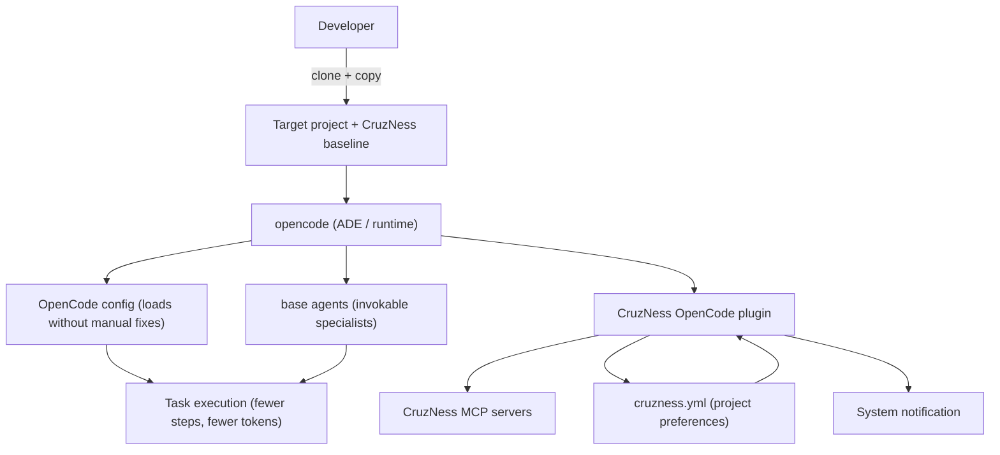

# ARCHITECTURE.md

> Big picture. Clear structure. Scalable.

# Architecture

High-level overview of the project structure, tech stack, and how everything connects.

## 01 System Overview

A visual view of how the baseline works and the main pieces involved.



Responses: agent output + file changes in the target project.

- **Developer**: clones CruzNess, copies the baseline into any project.
- **opencode**: executes the harness, owns config, agents and wiring.
- **Baseline**: OpenCode config, base agents, and project preferences ([FR-002..FR-004](PRD.md#21-functional-requirements)).
- **Target project**: where work happens; the CruzNess plugin runs inside OpenCode, not as a separate service.

## 02 Tech Stack

Tools and technologies used in the project.

- **ADE / Runtime**: opencode (only supported runtime in v1)
- **Baseline code**: JavaScript/TypeScript, aligned with OpenCode's plugin stack
- **Package manager**: npm for the YAML parser dependency

Out of v1 (decided in [PRD 1.4](PRD.md#14-non-goals)): profiles/advanced customization, automatic token measurement, multi-IDE support.

## 03 Project Structure

A simplified view of the folder structure.

```text
./
  ARCHITECTURE.md   # this overview
  PRD.md            # scope and acceptance criteria
  README.md         # clone + copy usage (FR-001)
  package.json      # harness runtime dependencies
  .opencode/plugins/ # auto-discovered plugins and adapters (FR-002)
  cruzness.yml.example # tracked project preference template
  agents/           # base agents, one line purpose each (FR-003)
  skills/           # base skills (find-skills, doc-design, work-unit-commits, skill-*)
  frontend/         # optional frontend package (UI + SEO + analytics), independent of core
  frontend/agents/  # ui + seo + analytics specialists, disjoint MCP allowlists
  frontend/skills/  # REGISTRY.md, skills-lock.json, sync scripts, vendored wrappers
  .opencode/skills/ # vendored frontend-design + design-taste-frontend (+ on-demand externals)
```

- [`README.md`](README.md): how to clone and copy the baseline ([FR-001](PRD.md#21-functional-requirements)).
- [`PRD.md`](PRD.md): frozen v1 scope and acceptance criteria.
- `ARCHITECTURE.md`: this overview, kept in sync with the two above.
- `.opencode/plugins/` + `agents/`: auto-discovered harness plugins and agents.
- `frontend/`: optional UI/SEO package; `cruzness.frontend` registers its MCPs
  only when `frontend` is true, and `frontend/scripts/sync-frontend.mjs`
  materializes or removes its agents and skills. OpenCode registers file-based
  agents and skills after every plugin setup, so a plugin cannot see, add, or
  remove them in V2.
- `cruzness.yml.example`: tracked template; the local `cruzness.yml` is Git-ignored.
- `.opencode/plugins/cruzness-notifications/`: local OpenCode plugin whose `tui.js` part reads the preference and handles notifications. Flat files under `.opencode/plugins/` load as server parts and cannot use the TUI context.

## 04 Data Flow

CruzNess has no standalone runtime. Execution behaviour belongs to opencode; its local plugin reads `cruzness.yml` and applies supported preferences.

1. Developer copies the baseline into a target project, installs npm dependencies, and copies `cruzness.yml.example` to `cruzness.yml`.
2. OpenCode loads its project config and CruzNess plugin; the plugin registers its MCP servers and reads the local YAML.
3. `frontend/scripts/sync-frontend.mjs` copies the frontend agents and vendored
   skills into `.opencode/` when `frontend` is true, or removes them when it is
   false. The `cruzness.frontend` plugin registers the frontend MCPs only when
   `frontend` is true; otherwise the package costs nothing.
4. The developer invokes an agent; OpenCode executes the task.
5. If enabled, the notification plugin sends a system notification after successful task completion.
6. A reference task is compared before/after to verify token saving ([metrics](PRD.md#4-success-metrics)).

## 05 Scalability & Future Considerations

Key areas to consider as the product grows.

- Add preferences only when the OpenCode plugin consumes and tests them.
- Watch total MCPs/tools per agent to avoid context bloat and atrophy (no fixed budget yet, to be measured).
- Extend `cruzness.yml` with project-specific modules and integrations as they are implemented.
- Define one reference task and record before/after tokens before claiming savings.
- Pin the supported opencode version; re-verify on upgrade.
- Repeat reference measurements 3x and compare averages (model output varies).
- Consider profiles and multi-IDE only after v1 ships.
