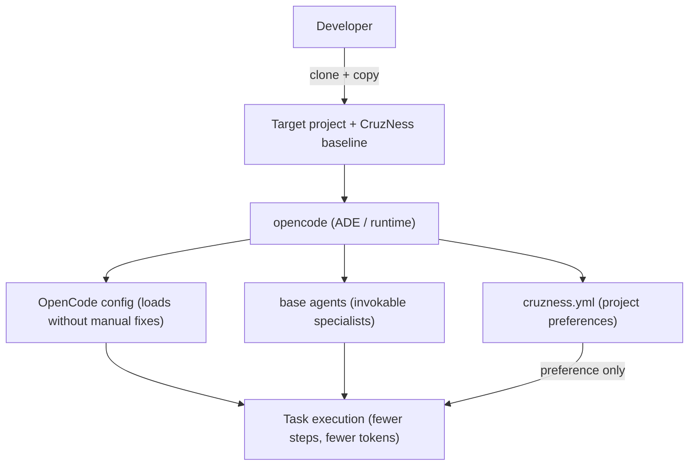

# ARCHITECTURE.md

> Big picture. Clear structure. Scalable.

# Architecture

High-level overview of the project structure, tech stack, and how everything connects.

## 01 System Overview

A visual view of how the baseline works and the main pieces involved.



Responses: agent output + file changes in the target project.

- **Developer**: clones CruzNess, copies the baseline into any project.
- **opencode**: executes the harness, owns config, agents and wiring.
- **Baseline**: OpenCode config, base agents, and project preferences ([FR-002..FR-004](PRD.md#21-functional-requirements)).
- **Target project**: where the work happens; baseline adds no runtime dependency.

## 02 Tech Stack

Tools and technologies used in the project.

- **ADE / Runtime**: opencode (only supported runtime in v1)
- **Baseline code**: TypeScript, aligned with opencode's stack
- **Package manager**: bun, if feasible ([TBD per PRD](PRD.md#3-constraints))

Out of v1 (decided in [PRD 1.4](PRD.md#14-non-goals)): profiles/advanced customization, automatic token measurement, multi-IDE support.

## 03 Project Structure

A simplified view of the folder structure.

```text
./
  ARCHITECTURE.md   # this overview
  PRD.md            # v1 scope FR-001..FR-003
  README.md         # clone + copy usage (FR-001)
  opencode.json     # base OpenCode config, loads cleanly (FR-002)
  cruzness.yml      # project-level CruzNess preferences
  agents/           # base agents, one line purpose each (FR-003)
  skills/           # base skills (find-skills, doc-design, work-unit-commits, skill-*)
```

- [`README.md`](README.md): how to clone and copy the baseline ([FR-001](PRD.md#21-functional-requirements)).
- [`PRD.md`](PRD.md): frozen v1 scope and acceptance criteria.
- `ARCHITECTURE.md`: this overview, kept in sync with the two above.
- `opencode.json` + `agents/`: OpenCode runtime config and agents.
- `cruzness.yml`: CruzNess-owned project preferences; OpenCode does not read it.

## 04 Data Flow

CruzNess has no runtime of its own. Execution behaviour belongs to opencode; `cruzness.yml` records project preferences but does not itself change OpenCode behavior.

1. Developer clones the repo and copies the baseline into the target project.
2. Target is opened with opencode; shipped config loads.
3. Developer invokes a base agent for the task.
4. opencode executes (tools, model loop) — not detailed here, see opencode docs.
5. Reference task is compared before/after to verify token saving ([metrics](PRD.md#4-success-metrics)).

## 05 Scalability & Future Considerations

Key areas to consider as the product grows.

- Keep runtime behavior in OpenCode; do not claim preferences are enforced until an integration consumes them.
- Watch total MCPs/tools per agent to avoid context bloat and atrophy (no fixed budget yet, to be measured).
- Extend `cruzness.yml` with project-specific modules and integrations as they are implemented.
- Define one reference task and record before/after tokens before claiming savings.
- Pin the supported opencode version; re-verify on upgrade.
- Repeat reference measurements 3x and compare averages (model output varies).
- Consider profiles and multi-IDE only after v1 ships.
